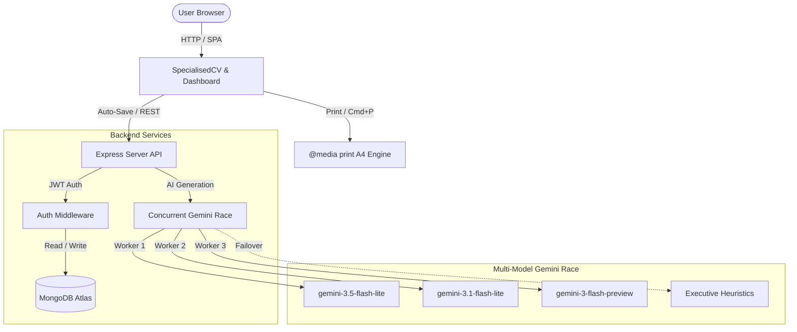

# 📄 AI-Powered Executive CV & Resume Builder

<div align="center">

[](https://nodejs.org/)
[](https://expressjs.com/)
[](https://www.mongodb.com/)
[](https://ai.google.dev/)
[](https://opensource.org/licenses/MIT)

**A full-stack, enterprise-grade resume builder featuring a concurrent multi-model Gemini AI assistant, real-time single-page A4 pagination, live MongoDB synchronization, and zero-whitespace print rendering.**

[Explore Features](#-features) • [Quickstart](#-quickstart) • [AI Engine](#-concurrent-gemini-ai-engine) • [API Reference](#-api-endpoints) • [Deployment](#-deployment)

---

</div>

## 🌟 Overview

The **Executive CV Builder** is a modern, single-page web application and RESTful backend engineered to create pixel-perfect, ATS-compliant software engineering and executive resumes. It pairs high-speed generative AI writing workflows with client-side document pagination and cloud persistence.

Whether generating quantified impact statements using Google's XYZ formula (`"Accomplished [X] as measured by [Y], by doing [Z]"`) or exporting vector-grade A4 PDFs with zero blank overflow pages, every detail is tuned for developer ergonomics and hiring manager impact.

---

## ✨ Features

### 🤖 High-Speed AI Resume Assistant
- **Concurrent Multi-Model Racing:** Employs parallel `Promise.any` racing across ultra-fast models (`gemini-3.5-flash-lite`, `gemini-3.1-flash-lite`, `gemini-3-flash-preview`) with sub-2-second response times and zero 503 unavailability bottlenecks.
- **Role-Specific Generators:** Dedicated modals for **Professional Summary**, **Work Experience**, **Projects**, **Training**, and **Skills**.
- **Floating Quick-Polish Bubble:** Highlight any text on the resume canvas to summon an instant AI rewrite button along with bold, italic, and underline shortcuts.
- **Google XYZ Formula:** Automatically structures bullets with active power verbs and quantified metrics (e.g., latency reduction %, active user counts).

### 📐 Precision Typography & A4 Page Engine
- **Single-Page Fit (`1-Page Fit`):** Dynamically scales font sizes and line heights so your resume stays strictly on 1 printable A4 sheet.
- **Multi-Page Mode:** True multi-sheet document flow for senior professionals with page break tags and page-number headers.
- **Zero Blank Page Printing:** Fully calibrated `@media print` rules eliminate unwanted trailing blank sheets and redundant margins in browser PDF exports.
- **Uniform Spacing:** Clean pipe divider normalization (`TechCorp | Bengaluru`) and single-row certificate formatting.

### 💼 Cloud Persistence & Dashboard
- **MongoDB Atlas Integration:** CVs auto-save to cloud storage with a 2.5-second debounce.
- **Full History Manager:** Complete `Undo` / `Redo` action stacks (`Ctrl + Z` / `Ctrl + Y`).
- **Dashboard Management:** Manage, rename, duplicate, preview, and delete multiple specialized versions of your CV.
- **JWT Authentication:** Secure user authentication using bcrypt password hashing and HTTP-only cookie-based sessions.

### 📤 Multi-Format Export
- **Print to PDF:** Direct browser print engine configured for native vector PDF generation.
- **Vector/Raster PDF:** 1-click client-side download via `html2pdf.js`.
- **Microsoft Word (.doc):** Generates compliant Word documents with formatted styling.
- **Plain Text ATS:** 1-click copy of clean, unformatted plain text for job board text fields.

---

## 🛠️ Tech Stack

| Layer | Technologies |
| :--- | :--- |
| **Backend** | Node.js, Express.js, Mongoose, JWT (`jsonwebtoken`), bcryptjs, cookie-parser |
| **Frontend** | Vanilla JavaScript (ES6+), HTML5, CSS3, FontAwesome 6, Google Fonts |
| **Database** | MongoDB Atlas (Cloud) / Local MongoDB |
| **AI Integration** | Google Gemini API (Multi-model racing engine) |
| **Export Tools** | html2pdf.bundle.js, Native CSS `@media print` |
| **Deployment** | Vercel (Serverless ready) / Node.js Host |

---

## 🏗️ Architecture



---

## 🚀 Quickstart

### Prerequisites
- [Node.js](https://nodejs.org/) v18.0.0 or higher
- [MongoDB Atlas](https://www.mongodb.com/atlas) connection string (or local MongoDB)
- [Google Gemini API Key](https://aistudio.google.com/)

### 1. Clone the Repository
```bash
git clone https://github.com/ashirwad682/CV--GENRATOR-1.git
cd CV--GENRATOR-1
```

### 2. Install Dependencies
```bash
npm install
```

### 3. Configure Environment Variables
Create a `.env` file in the root directory:
```env
PORT=3000
MONGODB_URI=your_mongodb_connection_string
JWT_SECRET=your_super_secret_jwt_key
GEMINI_API_KEY=your_google_gemini_api_key
```

### 4. Start the Application
```bash
# Start the production server
npm start

# Or start in development mode
npm run dev
```

Open your browser and navigate to:
```
http://localhost:3000
```

---

## ⚡ Concurrent Gemini AI Engine

To ensure sub-2-second generation speeds without hitting upstream Google `503 Service Unavailable` errors during peak loads, the backend features a **concurrent model race**:

```javascript
// Races 3 ultra-fast models in parallel — fastest response wins instantly
const tier1Models = [
    'gemini-3.5-flash-lite',
    'gemini-3.1-flash-lite',
    'gemini-3-flash-preview'
];

raceResult = await Promise.any(
    tier1Models.map(model => callSingleModel(model, postData, apiKey))
);
```

- **Tier 1 Race:** Executes 3 lightweight, high-throughput models simultaneously.
- **Tier 2 Failover:** Automatically steps into standard flash models if Tier 1 experiences high demand.
- **Zero Latency:** First model to return content immediately resolves the client request; pending requests are terminated.

---

## 📡 API Endpoints

### 🔐 Authentication
| Method | Endpoint | Description |
| :--- | :--- | :--- |
| `POST` | `/api/auth/register` | Register a new user account |
| `POST` | `/api/auth/login` | Login and receive an HTTP-only JWT cookie |
| `POST` | `/api/auth/logout` | Clear the session cookie |
| `GET` | `/api/auth/me` | Fetch currently authenticated user |

### 📄 CV Management (Protected)
| Method | Endpoint | Description |
| :--- | :--- | :--- |
| `GET` | `/api/cvs` | Get all CVs belonging to the authenticated user |
| `GET` | `/api/cvs/:id` | Fetch full CV document and rendered HTML |
| `POST` | `/api/cvs` | Create a new CV document |
| `PUT` | `/api/cvs/:id` | Save updated title and canvas content |
| `POST` | `/api/cvs/:id/duplicate`| Clone an existing CV |
| `DELETE` | `/api/cvs/:id` | Delete a CV |

### 🤖 AI Writing Assistant
| Method | Endpoint | Description |
| :--- | :--- | :--- |
| `POST` | `/api/ai/generate` | Generate executive bullets, summaries, or polish selections |

---

## 🚢 Deployment

### Deploying to Vercel
The repository includes a ready-to-use [`vercel.json`](file:///Users/ashirwadk/Project%20create%20by%20me%20/CV/vercel.json):
1. Push your repository to GitHub.
2. Import the project into your [Vercel Dashboard](https://vercel.com).
3. Set your environment variables (`MONGODB_URI`, `JWT_SECRET`, `GEMINI_API_KEY`) in the Vercel Project Settings.
4. Deploy!

---

## 🤝 Contributing

Contributions, issues, and feature requests are welcome!
1. Fork the Project
2. Create your Feature Branch (`git checkout -b feature/AmazingFeature`)
3. Commit your Changes (`git commit -m 'Add some AmazingFeature'`)
4. Push to the Branch (`git push origin feature/AmazingFeature`)
5. Open a Pull Request

---

## 📄 License

Distributed under the **MIT License**. See `LICENSE` for more information.

<div align="center">
  <sub>Built with ❤️ by <a href="https://github.com/ashirwad682">Ashirwad Kumar</a></sub>
</div>
